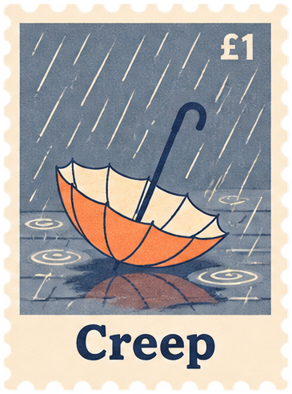
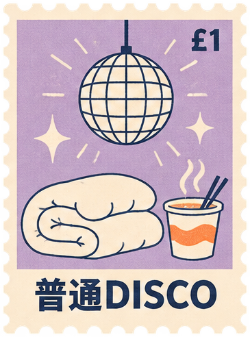
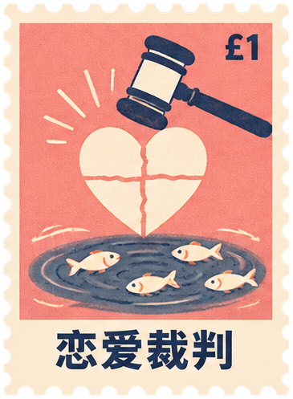
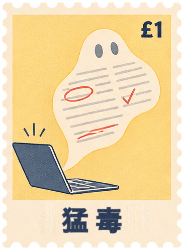
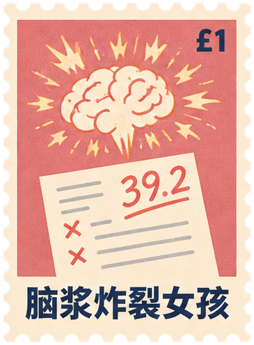

# 结局明信片：邮票和邮戳对照

从上一级的两张拼图切出来的（只裁切，原图本来就是透明底，没有抠图；只有「猛毒」那枚改了字）。重切：`python3 tools/cut_stamps.py`。

文件名是按图上印的字起的。用在哪个结局写在 `data/endings.js` 末尾的 `DATA.endingArt`：现在先按图上的字对上了（字和结局名一一对应；Cora 确认过「幽灵法则」就是「猛毒」），策划要换就改那张表；表里去掉的结局会回到文字占位。

## 邮票（`assets/ui/stamps/`，8 枚，365×495 左右）

| 文件 | 图上的字 | 画面 |
| --- | --- | --- |
|  `home.png` | 好久不见 | 飞机、窗里一碗面 |
|  `alien.png` | 外星人外星人 | UFO 照着一张证件、红砖排屋 |
|  `creep.png` | Creep | 雨里一把翻倒的橙色伞 |
|  `disco.png` | 普通DISCO | 迪斯科球、被子、泡面 |
|  `lonely.png` | 孤独患者 | 夜里的楼、只有一扇窗亮着、钟 |
|  `love_trial.png` | 恋爱裁判 | 法槌、裂开的心、鱼塘 |
|  `ghost_rule.png` | 猛毒 | 从电脑里飘出来的幽灵论文。原图写的是「幽灵法则」，结局改名后 Cora 让这边把字换成「猛毒」（`tools/stamp_mengdu.py`，冬青黑体 W6）；原图留在 `ghost_rule_orig.png` |
|  `brain_girl.png` | 脑浆炸裂女孩 | 爆炸的脑子、39.2 分的卷子 |

## 邮戳（`assets/ui/postmarks/`，9 枚，330–480 宽）

| 文件 | 图上的字 | 画面 |
| --- | --- | --- |
|  `senior_he.png` | 告白预演 | 两张机票、日出 |
|  `senior_be.png` | Money for Nothing | 裂开的英镑硬币、长收据（横椭圆） |
|  `local_he.png` | Wonderwall | 下雨的砖墙、心 |
|  `local_be.png` | 没有明天 | 撕掉一角的日历，两边有邮戳波浪线 |
|  `groupmate_he.png` | 融化 | 化掉的奶茶 |
|  `groupmate_be.png` | 吸血鬼 | 杯子、口红印（横椭圆） |
|  `otaku_he.png` | 神的随波逐流 | 纸船、樱花、海浪 |
|  `otaku_be.png` | 拜启二重身 | 一黑一白两张面具 |
|  `first.png` | First 威风堂堂 | 橙色火漆印、学位帽（形状和别的不一样） |
